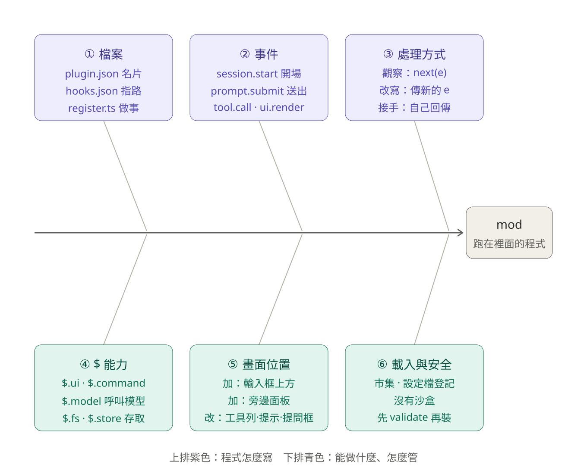

# mod 教學：跑在 Claude Code 裡面的程式

> 給 SA、PG、PM 看的。用我們每天在用的「工作台」（session-board）當例子，把 mod 從檔案、事件到安全一次講清楚。
> 更新：2026-10-16。依據：Claude Code 官方文件（見文末參考資料）與工作台實際程式 `hooks/register.tsx`。

## 0. 一句話

**mod 是一支跑在 Claude Code 裡面的程式。** Claude Code 每做一件事（開對話、您送出訊息、Claude 要用工具、畫面要重畫），就發出一個**事件**；事件先交給 mod，mod 決定**放行、改寫、或自己接手**。mod 要做程式以外的事（畫畫面、開指令、呼叫模型、讀檔案），一律透過 `$` 這個入口。

- 推出：2026-10-01（Anthropic 官方部落格）。
- 新版預設開啟：**桌面版 2.1.286 以上**（Code 分頁輸入 `/status` 看「Claude Code」那一列）；終端機 2.1.287 以上（`claude --version`）。

## 1. 魚骨圖：mod 的六根骨頭



文字版（看不到圖時用）：

```
  ① 檔案              ② 事件                ③ 處理方式
  plugin.json 名片     session.start 開場     觀察：next(e)
  hooks.json 指路      prompt.submit 送出     改寫：傳新的 e
  register.ts 做事     tool.call·ui.render    接手：自己回傳
        \                  \                     \
─────────┴──────────────────┴─────────────────────┴──────▶ 【mod：跑在裡面的程式】
        /                  /                     /
  ④ $ 能力            ⑤ 畫面位置             ⑥ 載入與安全
  $.ui · $.command     加：輸入框上方          市集 · 設定檔登記
  $.model 呼叫模型     加：旁邊面板            沒有沙盒
  $.fs · $.store       改：工具列·提示·提問框   先 validate 再裝
```

上排（①②③）是「程式怎麼寫」，下排（④⑤⑥）是「能做什麼、怎麼管」。下面各節依序展開。

## 2. 先分清楚：外掛、技能、MCP、鉤子、mod

您安裝的東西正式名字叫**外掛（plugin）**，它是一個資料夾，像收納盒。盒子裡可以放四種東西，**mod 只是其中一種**：

| | 是什麼 | 在 Claude Code 的哪裡 | 能不能畫畫面 | 寫什麼 |
|---|---|---|---|---|
| **技能（skill）** | 一份給 Claude 讀的說明（`SKILL.md`） | 外面 | 不能 | 文字（Markdown） |
| **MCP** | 外部程式，讓 Claude 多幾樣工具 | 外面 | 不能 | 任何語言的伺服器 |
| **鉤子（hook）** | 在某個時間點自動跑一段指令（寫在 `settings.json`） | 外面 | 不能 | 現成的腳本 |
| **mod** | 程式，Claude Code 在自己裡面呼叫它 | **裡面** | **能** | JavaScript／TypeScript |

**怎麼選：**

| 情況 | 用 |
|---|---|
| 同一段說明一直在對話裡重貼 | 技能 |
| 要讓 Claude 連到公司其他系統 | MCP |
| 某個時間點，自動跑一段現成的指令（擋掉或記錄） | 鉤子 |
| 要多一塊畫面、多一個指令，或改變 Claude Code 本身 | **mod** |

> 對照：資料夾裡的 [範本/meeting-minutes](範本/meeting-minutes)（會議紀錄整理）只有 `plugin.json` 和 `SKILL.md`，它是**技能外掛**，不是 mod。[範本/session-board](範本/session-board)（工作台）有程式，才是 **mod**。

## 3. ① 檔案：一個 mod 長什麼樣

以工作台為例：

```
session-board/
├─ .claude-plugin/plugin.json   名片：名稱、版本、說明
├─ hooks/hooks.json             {"modules": ["./register.tsx"]}  ← 有這行才算 mod
├─ hooks/register.tsx           程式本體：export register(on)
├─ types/index.d.ts             工作台自己的資料格式（Row、Mem…）
└─ .claude-plugin/types/…       Claude Code 自動產生：這個版本有哪些事件和功能
```

| 檔案 | 作用 |
|---|---|
| `plugin.json` | 讓 Claude Code 認得這是一個外掛 |
| `hooks.json` | 告訴 Claude Code 程式放在哪。**沒有它就只是普通外掛，有了它才會載入程式** |
| `register.tsx` | 真正做事的程式。匯出 `register(on)`，在裡面用 `on(...)` 登記要聽哪些事件 |
| 自動產生的 `types/` | 列出您這個 Claude Code 版本有哪些事件、`$` 功能，編輯器可以自動完成；版本更新時以這份為準 |

程式可以直接寫 `.js`／`.ts`／`.tsx`：**不用裝 Node.js、不用打包**，Claude Code 直接讀。

## 4. ② 事件 ＋ ③ 處理方式

### 4-1 每個處理函式長這樣

```ts
on('事件名稱', { 篩選條件 }, async ($, e, next) => {
  // $：對外做事的入口（見第 5 節）
  // e：這次事件的資料
  // next(e)：交給下一個 mod，最後回到 Claude Code 原本的行為
})
```

三種處理方式：

| 方式 | 怎麼寫 | 結果 |
|---|---|---|
| **觀察** | 做完自己的事，`return next(e)` | 照常進行，只是順便記一筆 |
| **改寫** | `return next(改過的 e)`，或拿 `next` 的結果再加工 | 照常進行，但內容被改了 |
| **接手** | 不呼叫 `next`，自己回傳結果 | 原本的行為不會發生 |

### 4-2 工作台實際聽了哪些事件

| 事件 | 工作台拿它做什麼 | 處理方式 |
|---|---|---|
| `session.start` | 註冊 `/board`、`/suggest`、`/board-others` 三個指令，讀取設定 | 觀察 |
| `prompt.submit` | 您一送出，就把狀態記成「執行中」，並用第一句話當對話名稱 | 觀察 |
| `prompt.compose` | 在系統提示多加一段「用台灣繁體中文回覆」 | **改寫** |
| `tool.call`（只看 TodoWrite） | 數待辦清單完成了幾項 | 觀察 |
| `turn.complete` | 累加 token 用量，狀態改成「閒置」 | 觀察 |
| `session.end` | 狀態改成「已結束」 | 觀察 |
| `command.run`（board／suggest／board-others） | 打開面板、送出建議請求、切換顯示 | **接手**（所以打指令不會讓 Claude 回答一輪） |
| `ui.render`（AbovePrompt） | 畫出輸入框上方的三排 | **接手**（自己畫） |
| `ui.render`（Pane ×2） | 畫右側的「工作台」和「記憶」面板 | **接手** |

### 4-3 照時間順序看一次

```
開對話 ─▶ session.start
您送出 ─▶ prompt.submit ─▶ 組系統提示 prompt.compose ─▶ 模型開始回答
Claude 用工具 ─▶ tool.call（每用一次就一次）
回答完 ─▶ turn.complete
關對話 ─▶ session.end
（期間畫面每次重畫 ─▶ ui.render）
```

## 5. ④ $ 能力：對外做事的唯一入口

工作台程式裡實際用到的：

| `$` 功能 | 工作台用來做什麼 |
|---|---|
| `$.ui.toast`／`$.ui.open`／`$.ui.resolve` | 跳出小提示、打開面板、取得畫面元件 |
| `$.command.register`／`$.command.run` | 註冊斜線指令；「整理重點」就是透過它執行 `/compact` |
| `$.prompt.fill` | 把字填進輸入框：「先規劃」「驗收提示」「設目標」都靠它 |
| `$.model.complete` | 呼叫模型：「記憶」翻成白話、「產生建議」。**會算進額度** |
| `$.fs.read`／`list`／`write` | 讀寫 `~/.claude/session-board/` 的狀態檔和記憶檔 |
| `$.store.get`／`set` | 記住「要不要顯示其他對話」這個設定 |
| `$.clock.now`／`$.clock.every` | 每 2 秒更新一次畫面上的數字 |
| `$.session.usage`／`id`／`cwd` | 讀這個對話的用量、編號、工作資料夾 |

**為什麼這很重要**：mod 對外做的所有事都必須經過 `$`，所以 `claude plugin validate` 不用執行程式，就能列出它聽了哪些事件（`hooks:`）、用了哪些功能（`calls:`）。「裝之前先檢查」做得到，原因就在這裡（見第 8 節）。

## 6. ⑤ 畫面位置：mod 能動哪幾塊

| | 位置 | 工作台的例子 |
|---|---|---|
| **新增** | 輸入框上方一條（AbovePrompt），可放按鈕、輸入框 | 三排：額度、用量、按鈕 |
| **新增** | 旁邊的面板（Pane） | 「工作台」「記憶」面板 |
| **改掉原本的** | 工具呼叫那一列、工作中的提示（spinner）、Claude 問您問題的對話框 | （工作台沒用到） |
| **改不了** | 權限確認視窗 | 刻意設計，避免 mod 偽裝確認框 |

哪裡看得到：終端機、桌面版 Code 分頁都會畫；VS Code 擴充套件 2.1.299 以上才會畫；`claude -p` 只跑程式、不畫畫面。

### 工作台三排一覽（2026-10-16 版）

| 排 | 內容 |
|---|---|
| 第 1 排：額度 | 5 小時、7 天額度（用了幾成、多久後重置）；**空間**（這個對話用了多少 %，綠→黃→紅） |
| 第 2 排：用量 | 送出／收到／快取的 token、對話數與執行中數量、合計金額 |
| 第 3 排：按鈕 | 見下表 |

| 按鈕 | 顏色 | 做什麼 | 點了會怎樣 |
|---|---|---|---|
| 工作台 | 藍 | 右側面板看狀態與下一步建議 | 只開面板，不改東西 |
| 記憶 | 藍 | 把 AI 的筆記翻成白話 | 只讀取，用一次模型 |
| 整理重點 | 琥珀（空間 ≥70% 變橘框） | 濃縮前面的對話，騰出空間 | **先問確認**；整理後無法還原 |
| 產生建議 | 紫 | 列出 2～3 個下一步 | 結果在工作台，點標題才填入輸入框 |
| 先規劃 | 青綠 | 放入 `/plan` | 按 Enter 才生效：只規劃、不動手 |
| 驗收提示 | 綠 | 放入「自己跑測試並貼出證據」 | 只填入輸入框，可改字再送出 |
| 設目標 | 靛 | 放入 `/goal ` | 接著打完成條件再按 Enter；`/goal clear` 取消 |
| 說明 | 灰 | 列出每顆按鈕的用法 | 只顯示 |
| 退回（沒有按鈕） | — | 輸入框連按兩次 Esc，或 `/rewind` | 選一個時間點退回 |

設計原則：會「做動作」的按鈕只把字放進輸入框，由您按 Enter 才執行（唯一例外是「整理重點」，它會先問）。要改按鈕文字或說明，改 `register.tsx` 開頭的 `GUIDE` 清單；改顏色，改 `BUTTON_COLOR`。

## 7. ⑥-1 載入與安裝

| 方式 | 適合 | 說明 |
|---|---|---|
| 外掛市集 | 裝別人分享的 | `/plugin install 名稱@市集` |
| `claude --plugin-dir 資料夾` | 終端機單次測試 | 桌面版不能帶啟動參數 |
| `~/.claude/dev-mods/<對話編號>/` | Claude 剛寫好的 | 只在那個對話載入，久了會被自動清掉 |
| **`settings.json` 的 `CLAUDE_CODE_PLUGIN_DIRS`** | **我們的做法（桌面版長期使用）** | 搭配 `CLAUDE_CODE_PLUGIN_DIR_WATCH: "1"`，改了程式自動重新載入 |

### 安裝工作台：用講的最簡單

打開 Claude Code，貼上這一句，下載與安裝都交給它：

```
請到 https://github.com/anson4139/claude-code-mod-tutorial 下載整個資料夾（用 ZIP 或 git clone，放到暫存位置），讀裡面的 session-board-設計規格與安裝.md，照第 6-2 節安裝 session-board。寫入前先告訴我會改哪些檔；做到第 4 步就停，重開由我自己來。
```

不想讓 Claude 下載的話，可以自己下載 ZIP 解壓縮，再請它讀本機的文件，做法見 [session-board-設計規格與安裝.md](session-board-設計規格與安裝.md) 的 6-1b。

Claude 會照文件做：複製到 `~/.claude/my-mods/`、換掉程式裡兩處路徑、建立 `~/.claude/session-board/`、**先備份** `settings.json` 再登記位置。裝好後完整關掉桌面版再打開，照驗證清單點一輪：

- 輸入框上方出現三排。
- 點「先規劃」：只填入 `/plan`，不會送出。
- 點「整理重點」：先跳出確認，按取消什麼都不會發生。

手動步驟與完整規格見 [session-board-設計規格與安裝.md](session-board-設計規格與安裝.md)。

## 8. ⑥-2 安全與關閉

mod **沒有沙盒**，權限跟您一樣：

- 能讀寫您的檔案、啟動程式、連網路。
- 讀得到環境變數和設定檔裡的金鑰。
- 看得到您送出的每一段話、Claude 的每一次工具呼叫。
- 能改寫訊息或工具呼叫，甚至在您被問之前先替您按同意。
- 能用您的額度呼叫模型。

所以安裝別人的 mod 之前：

1. **只裝信任的來源。**
2. **先檢查**：請 Claude 幫您跑 `claude plugin validate <資料夾>`。它只檢查、不執行，`hooks:` 列出聽了哪些事件、`calls:` 列出用了哪些功能。看到連網路、啟動程式，先想想它為什麼需要。
3. **改設定檔前先備份**（備份救得回改壞的設定，但擋不了惡意程式）。

關閉方式，由小到大：

| 範圍 | 做法 |
|---|---|
| 單一 mod | `/plugin` 的已安裝分頁停用；或請 Claude 把 `settings.json` 裡那一筆登記拿掉，重開 |
| 這一次全部 | 啟動時加 `--safe-mode`（連其他自訂一起關） |
| 每一次全部 | `settings.json` 設 `"disableAllHooks": true`（連鉤子、狀態列一起關） |
| 公司層級 | 管理員可用管理設定限制哪些 mod 能載入 |

## 9. 自己做一個：用講的請 Claude 寫

不用會寫程式。在對話裡直接說，例如：

```
做一個 mod，在輸入框上方顯示這個對話的空間用了幾成
```

過程：

1. Claude Code 內建 `plugin-authoring` 技能，Claude 會照著做，知道檔案放哪、能用哪些事件和功能。
2. 因為要寫進受保護的資料夾（`~/.claude`），**每建一個檔案都會先問您**，逐一按同意。
3. 第一次存檔時會問要不要在這個對話**開啟熱重載**，選啟用，這一輪結束 mod 就出現。不滿意直接跟它說要改哪裡。
4. **記得搬出來**：Claude 寫的 mod 放在 `~/.claude/dev-mods/<對話編號>/`，只在這個對話有效、久了會被清掉。請 Claude 把它搬到 `~/.claude/my-mods/`，再登記到 `settings.json`，以後每個對話都會載入。

找題目：把這段話貼給 Claude，讓它從您的對話紀錄找點子：

```
請看我最近二十個 Claude Code 的對話，找出我反覆交代的事、每次都要確認的步驟、還有我檢查成果的習慣。依這些提出五個 mod 的點子，說明各解決什麼困擾。只列點子，我挑好之前，先不要動手。
```

最後一句很重要，少了它，Claude 可能直接全部做出來。

## 10. 常見問題

| 狀況 | 可能原因 | 怎麼辦 |
|---|---|---|
| 裝了沒反應 | 沒有完整重開；版本太舊 | 完整關掉再開；`/status` 確認桌面版 2.1.286 以上 |
| 工作台沒出現 | 路徑沒換，或設定檔格式錯誤 | 確認 `register.tsx` 第 6、7 行已換成真實路徑；設定檔改壞就用備份還原 |
| Claude 寫的 mod 開新對話就不見 | 還在 `dev-mods` 裡 | 請 Claude 搬到 `my-mods` 並登記 |
| 改了程式沒變化 | 沒開自動重新載入 | 設 `CLAUDE_CODE_PLUGIN_DIR_WATCH: "1"`，或重開 |
| 懷疑 mod 造成怪問題 | — | 用第 8 節的關閉方式逐一排除 |

## 參考資料

- 官方部落格：Customize Claude Code with mods — https://claude.com/blog/claude-code-mods
- 官方文件：Mods overview — https://code.claude.com/docs/en/plugins/mods/overview
- 官方文件：Create a mod — https://code.claude.com/docs/en/plugins/mods/create
- 工作台規格與安裝：[session-board-設計規格與安裝.md](session-board-設計規格與安裝.md)
- 教學影片：YouTube 頻道 Anson Chiang
